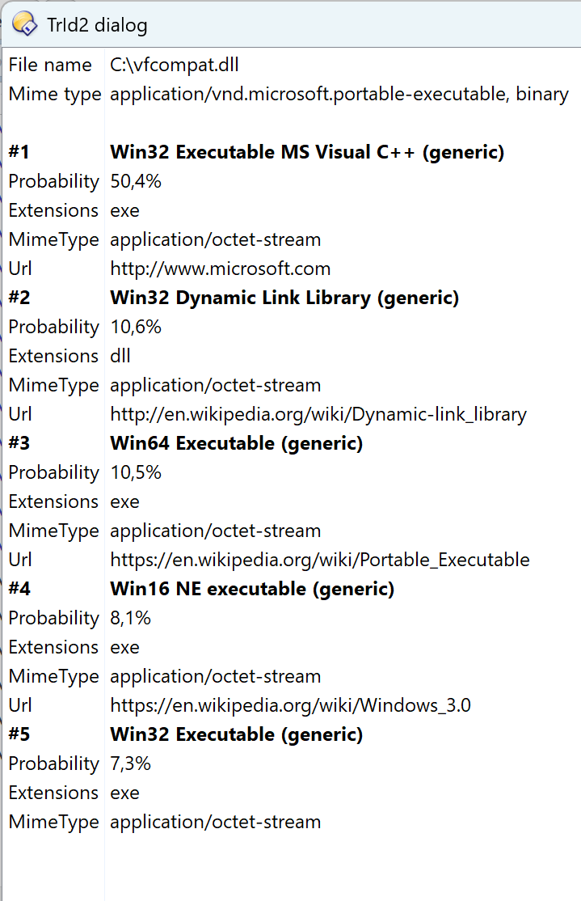
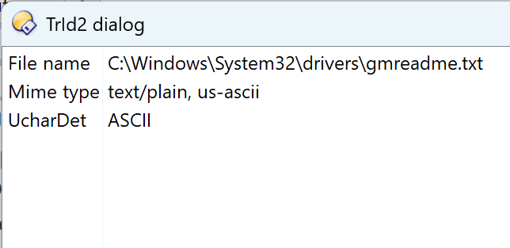

The plugin uses [DOpus-Scripting-Extensions](https://github.com/PolarGoose/DOpus-Scripting-Extensions) `TrId2` module to:
* Show a dialog with file type information
  * Mime type and encoding from [FileMimeTypeDetector](https://github.com/PolarGoose/DOpus-Scripting-Extensions#filemimetypedetector)
  * Encoding from [UCharDet](https://github.com/PolarGoose/DOpus-Scripting-Extensions#UCharDet)
  * File type candidates using [TrId2FileTypeDetector](https://github.com/PolarGoose/DOpus-Scripting-Extensions#trid2filetypedetector)
* Provide a command to fix the file extension

## How to install the script
* Install the latest version of `DOpus-Scripting-Extensions` from [DOpus-Scripting-Extensions Releases page](https://github.com/PolarGoose/DOpus-Scripting-Extensions/releases)
* Download the `DirectoryOpus-TrId2FileTypeDetector-dialog-and-commands.js` file from this project's [Releases page](https://github.com/PolarGoose/DirectoryOpus-TrId2FileTypeDetector-dialog-and-commands/releases)
* Copy the downloaded `.js` file to the `%AppData%\GPSoftware\Directory Opus\Script AddIns` folder
* See below how to use the dialog or fix file extension commands

## How to use "fix file extension" command
The script adds `TrId2FileTypeDetector_FixFileExtension` command to the Directory Opus.<br>
You can use it from the `User Commands` menu and create a custom user command:
```
@noprogress
TrId2FileTypeDetector_FixFileExtension FILE {filepath}
```
This also works if you select many files. Folders are skipped.
When you apply this command to a file, the following happens:
* It detects the most probable type of the file
* Then it replaces the file extension with the detected extension

For example, suppose you have a zip archive with the wrong extension, such as `archive.png`. The `TrId2FileTypeDetector_FixFileExtension` command will rename it to `archive.zip`

## How to use the GUI dialog
The script adds `TrId2FileTypeDetector_OpenDialog` command to the Directory Opus.<br>
You can use it from the `User Commands` menu and create a custom user command:
```
@noprogress
TrId2FileTypeDetector_OpenDialog FILE {filepath}
```
### GUI dialog screenshots
Binary file<br>
<br>
Text file<br>

